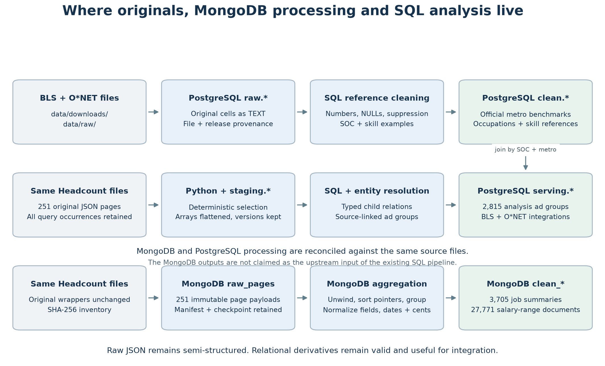
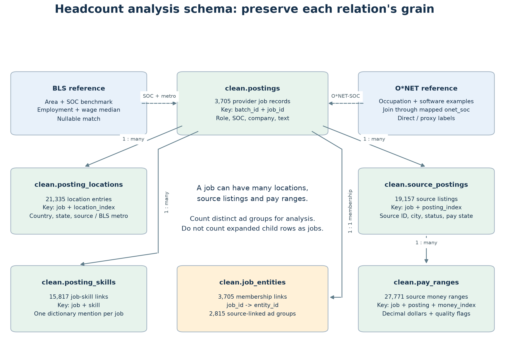

# Data collection, cleaning and access guide

For report/video teammates. This is the main explanation of **why we chose the data, how processing works, and exactly where to find the originals and processed datasets**. The executed [notebook](../notebooks/Milestone2_Data_Walkthrough.ipynb) shows progressive MongoDB/SQL cells and real before/after examples. The [HTML copy](../reports/Milestone2_Data_Walkthrough.html) can be read without Python or database credentials.

## 1. How the storage choices meet the assignment

The course requires at least three complementary real datasets, including one semi-structured/unstructured dataset. Headcount's nested job JSON is that semi-structured source. Converting useful fields to SQL rows does not change the format or provenance of the preserved original dataset.

Requirements C10–13 call for tabular source data in PostgreSQL, suitable JSON storage and separation of original/processed data. D17 allows flattening semi-structured data; D19 explicitly permits MongoDB queries for semi-structured processing. **We should retain the PostgreSQL derivatives.** The assignment does not require exclusive storage or prohibit a JSON source from contributing analysis-ready relational tables.

Our choices are therefore:

- **MongoDB:** original Headcount page payloads and separate processed job/salary collections. Variable arrays and field-state wrappers remain inspectable. MongoDB aggregation performs actual initial cleaning on the server.
- **PostgreSQL:** original government source cells as TEXT, versioned flattened Headcount snapshots, typed/flagged clean relations and integrated analysis views. SQL joins are suited to SOC codes, metro codes and normalized child relations.
- **Local original files plus a team backup:** exact ZIP/XLSX/CSV/JSON bytes and checksums. MongoDB stores the original JSON object under `payload`; exact file formatting/bytes remain in the source files.

The SQL pipeline and MongoDB pipeline currently start from the **same unchanged local Headcount files**. The new MongoDB summaries are not claimed as the upstream input to the previously built PostgreSQL tables. We cross-checked both implementations instead: selected source files, IDs, occurrence counts, missingness states and every salary value/eligibility flag agree.



## 2. Why these sources and how collection was performed

| Dataset | Why we need it | Acquisition and original contents |
|---|---|---|
| [BLS May 2025 OEWS](https://www.bls.gov/oes/tables.htm) | Official employment denominators and pay benchmarks for the location/pay questions | Original government ZIP contains metropolitan (`MSA`) and nonmetropolitan (`BOS`) workbooks and documentation. We preserve both: 150,023 metro + 48,689 nonmetro rows. The original loader's first-workbook mistake was corrected by appending the missing metro file. |
| [O*NET 31.0](https://www.onetcenter.org/database.html) | Occupational definitions, SOC correspondence, software examples and contextual skill ratings | Original CSV ZIP is retained in full. We load Occupation Data (1,016 rows), Software Skills (31,821) and Essential Skills (18,200). These are component files of one reference dataset. Other downloaded components remain archived. |
| [Headcount Labs Jobs API](https://headcountlabs.com/docs/) | Observed job titles, descriptions, employers, locations and source salary evidence | Replaced Adzuna after Milestone 1's subscription/access concerns. The adopted collector saves the request filters, response object, retrieval time and usage metadata for every page, including empty responses. No new jobs API requests were made during the database/notebook work. |

The Headcount collection uses nine title searches covering six role groups across **PA, NY, CA, TX, WA, MA, IL, VA, GA and NC**. It requests current jobs ordered by update time, with page size 25, a per-title cap of 1,000 returned records, a total cap of 9,000 and no explicit posting-date window. Five common titles reached their per-title caps. All 90 state/title segments have saved responses; five were empty.

The resulting snapshot contains **251 pages, 5,635 returned occurrences and 3,705 provider job IDs**. Existing checkpoints make acquisition resumable only with the same settings. For the video, show the saved original files and scripts; rerunning the paid/quota-limited jobs API is unnecessary.

This is a purposive ten-state sample, shaped by caps, ordering, provider coverage, repeated ads and employer concentration. Cleaning cannot make it nationally representative. Report results as descriptions of **our collected ads**; national demand rankings need a different acquisition/sampling design.

## 3. What MongoDB cleans, and why raw data stays intact

The executed entry point is `scripts/ingest_headcount_mongo.py`; reusable aggregation stages are in `scripts/mongo_pipeline.py`. MongoDB's [aggregation pipeline](https://www.mongodb.com/docs/manual/core/aggregation-pipeline/) processes documents through stages. Only the final [`$merge`](https://www.mongodb.com/docs/manual/reference/operator/aggregation/merge/) writes processed output, and it targets the clean collections below.

| Step | Before | Operation / reason | After |
|---|---|---|---|
| Preserve pages | Original response wrappers on disk | Store each complete parsed wrapper under `raw_pages.payload`, with original path/hash. Deterministic technical IDs prevent retry copies, not problematic source rows. | 251 original page documents, including five empty pages; manifest/checkpoint preserved separately. |
| Expand occurrences | Job arrays inside pages | `$unwind` exposes returned occurrences and their query/file/index provenance. | All 5,635 occurrences remain recoverable. |
| Select a canonical provider record | Same job ID found by several queries | Convert source timestamps to dates; sort small source pointers by update/curation/path/index; `$group` selects deterministically and retains query matches/counts. Fetch selected text/arrays afterward to respect the cluster's 32 MB sort limit. | 3,705 canonical job summaries, each pointing to its original page and array index. |
| Normalize wrappers/text | `known`, `derived`, `source_omitted`, `source_unmapped`, `extraction_failed` | Normalize whitespace only for usable values, type dates, retain missingness labels and normalized location arrays. | Missing descriptions remain NULL with their reason. No invented descriptions, employers, locations or salaries. |
| Normalize money | Nested source-posting `money[]` values in cents, mixed currency/period | Unwind arrays; use Decimal128 conversion and divide by 100. When a usable `pay.value` exists but `money[]` is absent, use its ranges with explicit fallback provenance. | 27,771 processed range documents, linked to job/posting/money indexes and original page pointers. |
| Flag salary eligibility | Incomplete, nonannual, unknown-period and suspect ranges mixed with useful pay | Require positive ordered min/max, `ok` amount statuses, known source pay, USD, explicit `year`, min ≥ $15,000 and max ≤ $1,000,000. | 23,388 eligible source range entries. Other entries remain stored and flagged. These are source entries, not job counts. |

An example in the notebook converts **22,000,000 cents → $220,000** without guessing the period. Unknown/hourly/monthly periods are preserved and excluded from the primary annual comparison. A missing or failed source salary extraction does not prove an employer withheld salary.

Raw pages are never cleaned in place. Imported payloads were read back and compared with their original JSON objects, and all original-file SHA-256 hashes remain unchanged. Repeated MongoDB ingestion inserted **zero additional raw pages** and left processed counts stable.

## 4. What Python/PostgreSQL additionally clean and integrate

| Work | Why and handling |
|---|---|
| Structured raw ingestion | Every selected BLS/O*NET source field remains TEXT in `raw.*`, with file/release provenance. Existing rows are reconciled against the files; missing files append. Raw tables are not replaced. |
| Government types and suppression | SQL trims values, casts only valid numerics and maps blanks/`*`/`**`/`#` to NULL with reason flags. Top-coded/suppressed values are not zero or exact wages. O*NET Y/N flags become nullable booleans; rating scale and suppression context remain. |
| Role/SOC assignment | Conservative title rules assign the six roles. `config/role_mappings.csv` stores BLS/O*NET codes and direct/proxy labels. Five mappings are proxies; product-manager and generic analyst matches need cautious interpretation. |
| Nested arrays | Separate provider jobs, locations, source listings, money ranges and skill links. Preserve a stable parent/index key so expanded arrays do not become extra jobs. |
| Source-linked entity resolution | Job IDs alone still repeat some ads. Connect IDs only through shared source-posting IDs and matching nonempty employer/title/role. Preserve all 3,705 provider records and membership links; analysis uses 2,815 source-linked ad groups. Thirty-four records with conflicting source identity evidence stay flagged, with differing identities kept separate. Equal descriptions alone never trigger a merge. |
| Geography | Require explicit U.S. evidence; never substitute a search-state filter for a job location. Verify source CBSA against BLS 2025. Keep foreign, nonmetro, unresolved and multi-location entries. The single-job preview assigns a metro only when all U.S. locations support the same verified metro. |
| Skills | Apply the same limited alias dictionary to job title/available description and O*NET Software Skills examples. Missing text is not negative skill evidence; a missing alias match does not prove O*NET omits a concept. |
| SQL integration | Join mapped SOC and verified metro to BLS. Primary pay comparisons additionally require listed source evidence, supported source-city/state matching, no explicit remote evidence and one unique annual range per ad group/metro. Current output: 1,072 non-additive ad-group/metro comparison rows. |

The four larger clean relations are typed, indexed materialized views. They are rebuilt within the load transaction; versioned staging and raw sources are retained. `serving.analysis_jobs` contains the grouped analysis unit. `serving.postings_with_bls` intentionally retains one row per provider job for reconciliation. Other serving summaries use all group members' child evidence, not only a representative's location/text.



## 5. Exactly where teammates can access the datasets

### MongoDB Atlas / Compass

- **Cluster host:** `aijobmarketcluster.7irkp1a.mongodb.net`
- **Database:** `ai_job_market`
- **Connect:** use `MONGODB_URI` from your authorized local `.env`; in Atlas/Compass open the database and the collection listed below. No password is included in the notebook or documentation.

| Collection | What is there | Current source/version count |
|---|---|---|
| `raw_pages` | Original page wrappers under `payload`, source-file paths and hashes | 251 pages / 5,635 occurrences / 5 empty pages |
| `collection_manifests` | Original manifest and checkpoint content | 2 documents |
| `clean_job_summaries` | Initial MongoDB-cleaned jobs, field states, dates, locations and source pointers | 3,705 documents |
| `clean_pay_ranges` | Decimal-dollar ranges and quality/eligibility flags | 27,771 documents |
| `ingestion_runs` | Completed source/clean-version registration and actual counts | 1 completed source/version run |

For the current snapshot, filter raw documents with:

```json
{"source_snapshot": "hc_source_eea46d64c7da954d7bab"}
```

For processed documents, add the current cleaning version:

```json
{"source_snapshot": "hc_source_eea46d64c7da954d7bab", "clean_version": "mc_e6b15bd4d4ef57ed176b"}
```

Read the current values from `reports/mongodb_ingestion.json` after any future acquisition/rule change. Processed versions can coexist; do not sum them. The initially empty `ai_job_market` collection was left untouched and is not one of the ingested datasets.

### PostgreSQL / pgAdmin / SQL client

- **Host:** `ai-job-market-group07.c3ckyiegwuxb.us-east-2.rds.amazonaws.com`
- **Port:** `5432`
- **Database:** `ai_job_market`
- **Connect:** use the authorized `DATABASE_URL` in your local `.env`. In pgAdmin, expand **Databases → ai_job_market → Schemas** and the relevant schema below. Materialized clean outputs appear under **Materialized Views**, not ordinary Tables.

| Schema / relation | What to use it for |
|---|---|
| `raw.oews_metro` | All 198,712 original BLS source rows as TEXT, both metro/nonmetro |
| `raw.onet_occupation`, `raw.onet_software_skills`, `raw.onet_essential_skills` | Original selected O*NET source cells |
| `staging.headcount_*` | Flattened/versioned snapshots, every query occurrence and entity membership. Filter by `audit.active_batch` when inspecting manually. These are not the original nested JSON. |
| `clean.postings` | 3,705 accepted provider job records with role/SOC, text, provenance and salary convenience flags |
| `clean.posting_locations`, `clean.source_postings`, `clean.pay_ranges`, `clean.posting_skills`, `clean.job_entities` | Location/listing/range/skill/group relations at their documented grains |
| `clean.bls_metro_benchmarks`, `clean.onet_occupations`, `clean.onet_skills`, `clean.onet_essential_skills` | Processed government references |
| `serving.analysis_jobs` | 2,815 source-linked ad groups; main analysis unit |
| `serving.postings_with_bls` | One-provider-row preview with conservative single-metro BLS join |
| `serving.metro_sample_counts`, `serving.salary_comparisons`, `serving.role_skill_comparison`, `serving.state_salary_field_coverage` | Initial integrated summaries for the four questions |
| `audit.source_files`, `audit.headcount_batches`, `audit.active_batch` | Source/file/run provenance and the activated PostgreSQL batch |

The current PostgreSQL batch is `hc_c23c7bb86f43c8505bb8`. Unlike a source snapshot ID, this batch also fingerprints transformation rules. Do not manually change `audit.active_batch`; activate through the pipeline so materialized outputs remain consistent.

### Original files and saved report evidence

Paths below are relative to this repository's root, currently `D:\文档\研究生\95815 Data Engineering\Team Project\Mapping-the-U.S.-AI-Job-Market`:

| Path | Contents |
|---|---|
| `data/downloads/bls_2025_metro.zip` | Exact original BLS archive |
| `data/raw/bls_2025_metro/oesm25ma/` | `MSA_M2025_dl.xlsx`, `BOS_M2025_dl.xlsx`, `file_descriptions.xlsx` |
| `data/downloads/onet_31_0_csv.zip` | Exact original O*NET archive |
| `data/raw/onet_31_0_csv/db_31_0_csv/` | Original O*NET CSVs and readme |
| `data/raw/headcount_10states/states/<STATE>/<title>/page_*.json` | Original Headcount wrappers; root also contains `manifest.json` and `checkpoint.json` |
| `reports/raw_file_manifest.json` | SHA-256 inventory of all 304 original/download files |
| `reports/data_quality.json` and existing report CSVs | PostgreSQL QA, source/role/geography quality and actual results |
| `reports/mongodb_ingestion.json`, `reports/mongodb_quality.json`, `reports/data_access.json` | Actual Mongo ingestion, cross-store checks and credential-free access inventory |
| `docs/figures/` | PNG/SVG schema and duplicate-handling visuals for the report/video |

Local original files are ignored by Git. MongoDB now gives the team a cloud copy of the Headcount JSON, but the government archive/other original-file shared backup still needs the team to establish its shared Drive/object-storage location. Access from this computer was verified; each teammate still needs authorized database credentials, network access and access to any shared backup. This document does not claim those individual grants were completed.

## 6. Reproduce and present the work

Open the executed notebook in VS Code/Jupyter and select the repository's `.venv` interpreter to rerun. Install `requirements-notebook.txt` if needed. Saved outputs and the HTML copy are sufficient for reading/recording; do not display `.env` or connection-string values.

The notebook contains inline MongoDB aggregation and SQL preview cells, before/after tables, storage/schema diagrams, a duplicate-handling chart, integrated result samples and a five-minute video route. Its normal Run All is read-only for both databases. Production `.py`/`.sql` files remain the reusable implementation; teammates do not need to manually execute separate SQL files for the walkthrough.

To rebuild the MongoDB portion and validate it:

```powershell
.\.venv\Scripts\python.exe scripts/ingest_headcount_mongo.py
.\.venv\Scripts\python.exe scripts/audit_mongodb.py
.\.venv\Scripts\python.exe scripts/build_walkthrough.py
```

The original PostgreSQL audit has 19 passing assertions; MongoDB/cross-store validation adds 11 passing checks. It compares **every** salary key/value/eligibility flag, not a small example. All 304 original files remain unchanged, and both datastores retain their raw/processed separation. See the detailed [audit](MILESTONE2_DATA_AUDIT.md) and [dictionary](DATA_DICTIONARY.md) for limitations and relation grains.
